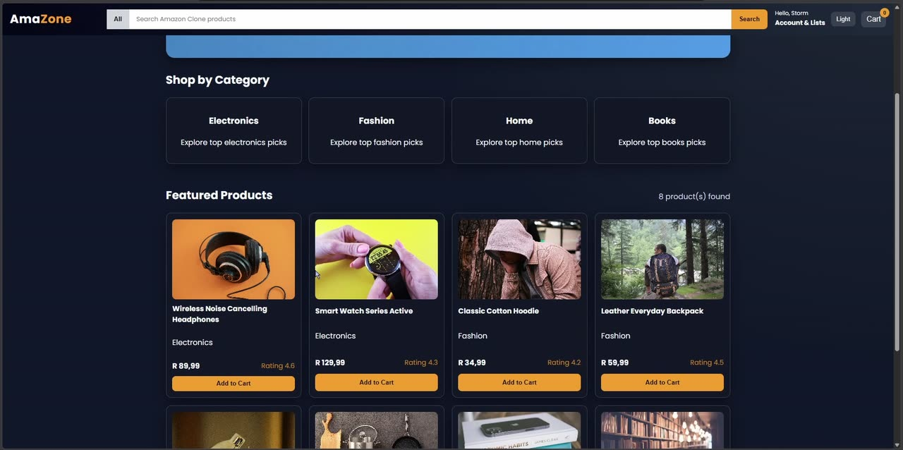
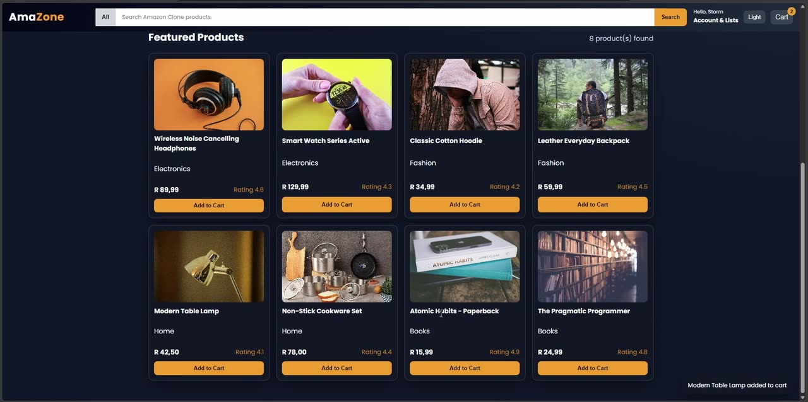

# Amazon Clone ("AmaZone")

A recreation of the Amazon storefront that I built with plain HTML, CSS and JavaScript, no frameworks. The idea was to get the look and feel of the real site as close as I could, and then make the shopping part actually work: browsing, searching, filtering and a cart that remembers what you put in it.



## What it does

- Products are rendered from a list in `script.js`, with photos, ratings and prices in rands
- **Shop by category** cards and a filter menu to narrow down the products
- A **search bar** that filters the products when you press Enter or click Search
- **Add to Cart** pops up a little notification, and the cart slides out from the side with quantities, a subtotal, a remove button for each item and a clear cart button
- The cart and your light/dark theme choice are saved in `localStorage`, so they're still there when you come back
- A menu button for smaller screens



## Tech

- **HTML, CSS and vanilla JavaScript**
- `localStorage` to keep the cart and theme between visits
- `Intl.NumberFormat` to show prices properly in rands

## What's in here

```
Amazon-Clone/
├── index.html      the page layout: navbar, banner, categories, products, cart panel
├── style.css       all the styling, including the dark theme
├── script.js       the product list, rendering, search, filters, cart and theme
└── resources/      product photos
```

## Running it yourself

There's nothing to install. Just open `index.html` in your browser, or use the Live Server extension in VS Code if you want it to reload as you make changes.

## How it works

Everything on the page is drawn from the `products` list at the top of `script.js`. Searching, picking a category or using the filter menu just changes what gets passed to `renderProducts()`, which redraws the product grid. The cart works the same way: it's an array that gets saved to `localStorage` every time it changes, and `renderCart()` redraws the panel from it.

## Challenges I ran into (and how I fixed them)

**Getting it to actually look like Amazon.** The first version worked but didn't really feel like the real thing. I spent a lot of time comparing it side by side with Amazon and restyling things like the buttons, the top navbar and the product cards until they matched more closely.

**Knowing that Add to Cart actually worked.** Clicking Add to Cart didn't give you any feedback unless you opened the cart, so it felt like nothing was happening. I added a small notification that pops up every time something gets added.

## What I'd improve next

- A product page for each item, instead of only the grid
- A checkout flow, even a pretend one, to finish off the shopping experience
- Loading the products from a real API or database instead of a hardcoded list
